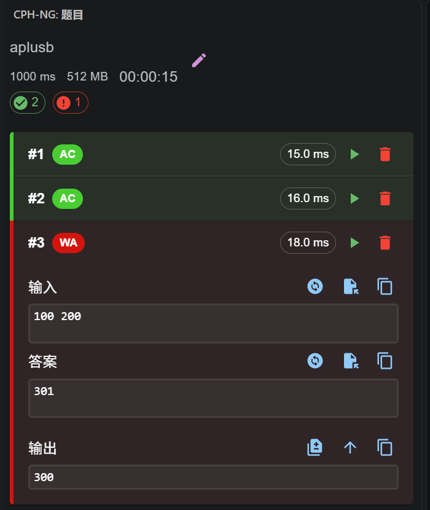
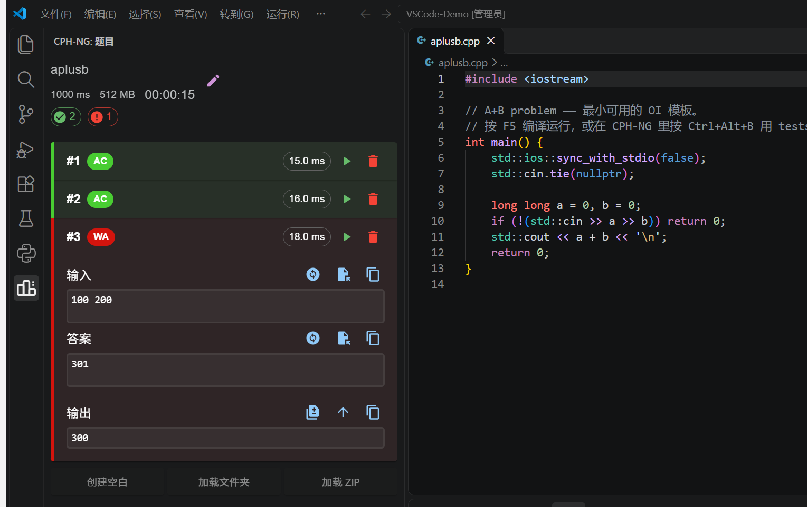

# VS Code OI 环境

把 VS Code 配成 **Dev-C++ 那种手感**，再加一套 **在线评测机的本地体验**：按 `F5` 直接编译运行，填几组样例按 `Ctrl+Alt+B` 就逐组告诉你 AC / WA / TLE。

> 面向 Windows + MinGW-w64（g++）+ OI/算法刷题场景。实测于 VS Code 1.144.0 / g++ 16.2.0 / Windows 11 28000。

## 三个能力

| 能力 | 按键 | 效果 |
| --- | --- | --- |
| 编译 + 运行 | `F5` | `g++ -O2 -std=c++17 -Wall -Wl,--stack=268435456 -static` → 立即执行，终端里可直接敲输入 |
| 只编译 | `Ctrl+Shift+B` | 只查语法错误，不运行 |
| 样例评测 | `Ctrl+Alt+B` | CPH-NG 逐组比对输入/输出，给出 AC / WA / TLE / RE / CE 等判定 + 耗时 |
| 断点调试 | 左侧「运行和调试」 | gdb 调试，与 F5 互不干扰 |

## 效果

判题面板：每组样例的判定、耗时、输入 / 答案 / 实际输出都在一个面板里，`#3` 是故意写错的答案，直接标红 `WA` 并显示实际输出 `300` 与预期 `301` 的差异。



完整窗口（左侧 CPH-NG 判题，右侧代码）：



## 快速开始

### 方式一：一键脚本（推荐）

```powershell
git clone https://github.com/<your-name>/vscode-oi-env.git
cd vscode-oi-env
powershell -ExecutionPolicy Bypass -File .\scripts\install.ps1
```

脚本会做四件事：

1. 探测 VS Code / g++ / python 的位置（找不到 g++ 会直接报错退出，不会写坏配置）
2. 按 `config/extensions.txt` 安装 10 个扩展
3. 把 `config/settings.patch.json` **合并**进你的用户 `settings.json`（保留你原有配置，冲突时以本仓库为准）
4. 把 `template/` 复制到 `~\Documents\OI`（已存在的文件不覆盖），并把模板里的绝对路径替换成你机器上的实际路径

常用参数：

```powershell
.\scripts\install.ps1 -Target D:\OI          # 换目标目录
.\scripts\install.ps1 -SkipExtensions        # 只写配置
.\scripts\install.ps1 -SkipConfig            # 只铺模板
```

### 方式二：手动

1. 装扩展：把 `config/extensions.txt` 里的 ID 逐个 `code --install-extension <id>`
2. 打开 `config/settings.snippet.json`，把内容按需合并进 `%APPDATA%\Code\User\settings.json`（改掉里面的 `<you>` 和 g++ 路径）
3. 把 `config/keybindings.json` 合并进 `%APPDATA%\Code\User\keybindings.json`
4. 把 `template/` 整个复制成你的题目目录，用 VS Code **打开这个文件夹**（必须打开文件夹，见下）

## 目录结构

```
vscode-oi-env/
├─ template/                  # 复制到题目目录就能用
│  ├─ .vscode/
│  │  ├─ tasks.json           # F5 → 编译并运行；Ctrl+Shift+B → 只编译
│  │  ├─ run-cpp.bat          # 真正干活的脚本（编译参数都在这里）
│  │  ├─ compile-only.bat
│  │  ├─ launch.json          # gdb 调试配置
│  │  ├─ c_cpp_properties.json# IntelliSense 指向 w64devkit 头文件
│  │  ├─ settings.json
│  │  └─ extensions.json      # 打开时推荐安装的扩展
│  ├─ examples/aplusb.cpp     # A+B 模板
│  ├─ examples/hello.py
│  └─ tests/1.in 1.ans 2.in 2.ans   # 供 CPH-NG「From folder」导入
├─ config/
│  ├─ settings.patch.json     # 脚本用（含占位符）
│  ├─ settings.snippet.json   # 人读版（带注释）
│  ├─ keybindings.json        # F5 绑定
│  └─ extensions.txt
├─ scripts/install.ps1
└─ docs/
   ├─ implementation.md       # 每条配置为什么这么写
   └─ troubleshooting.md      # 踩过的坑
```

## 实测环境

| 组件 | 版本 / 位置 |
| --- | --- |
| VS Code | 1.144.0 |
| 编译器 | MinGW-w64 g++ 16.2.0（w64devkit，含 gdb 18.1 / objcopy） |
| Python | 3.12.10（Pylance + debugpy） |
| 扩展 | cpptools、Python、Pylance、Markdown All in One、markdownlint、Code Runner、CPH-NG、中文语言包 |

## 实测结果

编译一轮 + 运行 ≈ **0.6 秒**；CPH-NG 判题日志：

```
g++.exe hello.cpp -O2 -std=c++17 -Wall -DCPH -Wl,--stack=268435456 -o %TEMP%\cph-ng\hello.exe
样例1（答案一致）            -> AC (18 ms)
样例2（288.50 写成 288.5）   -> WA (19 ms)
```

## 两个前提（很容易踩）

1. **必须「打开文件夹」再按 F5**。VS Code 的任务是工作区级的，直接双击打开单个 `.cpp` 时没有 `.vscode/tasks.json`，F5 不会有任何反应。
2. **`.bat` 里不要写中文**。cmd 按系统 ANSI 代码页解析批处理，UTF-8 中文会被拆坏（表现为 `'件' is not recognized`）。仓库里的脚本都是纯 ASCII。

更多细节见 [docs/implementation.md](docs/implementation.md) 与 [docs/troubleshooting.md](docs/troubleshooting.md)。

## License

MIT
